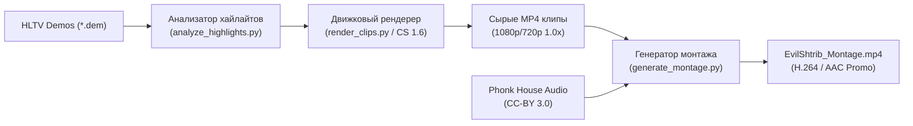

# Руководство и правила создания промо-монтажа EvilShtrib Highlights

Данный документ содержит полное техническое описание архитектуры, алгоритмов, математических моделей эффектов и правил автоматизированного создания промо-видеороликов (хайлайтов) для CS 1.6 сервера **EvilShtrib > Classic Biohazard**.

---

## Содержание
1. [Общая архитектура пайплайна](#1-общая-архитектура-пайплайна)
2. [Парсинг и аналитика демозаписей (HLTV Protocol 48)](#2-парсинг-и-аналитика-демозаписей-hltv-protocol-48)
3. [Правила отбора лучших моментов (Scoring System)](#3-правила-отбора-лучших-моментов-scoring-system)
4. [Headless-рендеринг в движке GoldSource](#4-headless-рендеринг-в-движке-goldsource)
5. [Правила монтажа и тайминга (Cut & Timing Rules)](#5-правила-монтажа-и-тайминга-cut--timing-rules)
6. [Музыкальное оформление и битсинк (Audio Design)](#6-музыкальное-оформление-и-битсинк-audio-design)
7. [Математика и алгоритмы визуальных эффектов (Kill FX)](#7-математика-и-алгоритмы-визуальных-эффектов-kill-fx)
8. [Процедурная графика и брендинг (HUD, Intro, Outro)](#8-процедурная-графика-и-брендинг-hud-intro-outro)
9. [Сборка, мультиплексирование и компрессия (FFmpeg Mastering)](#9-сборка-мультиплексирование-и-компрессия-ffmpeg-mastering)
10. [Инструкция по перезапуску и расширению](#10-инструкция-по-перезапуску-и-расширению)

---

## 1. Общая архитектура пайплайна

Пайплайн полностью автономен и состоит из пяти последовательных стадий:



1. **Анализ:** Чтение сетевых пакетов HLTV-демок, извлечение событий `DeathMsg`, фильтрация зомби-модов, расчет очков крутости моментов.
2. **Захват кадров:** Управление клиентом Half-Life/CS 1.6 через конфигурационные скрипты (`.cfg`), покадровый вывод в BMP на фиксированном тикрейте 30 FPS.
3. **Обрезка (Trimming):** Вырезание мертвого времени без потери предыстории и последствий выстрела.
4. **Спецэффекты (VFX):** Математическая обработка матрицы каждого кадра в NumPy/OpenCV (вспышки, хроматические сдвиги, зум-панчи, глитчи, шейки).
5. **Финальный мастеринг:** Синхронизация с 808-sub басом, процедурный брендинг сервера, двухпроходное кодирование H.264/AAC.

---

## 2. Парсинг и аналитика демозаписей (HLTV Protocol 48)

HLTV-демозаписи GoldSource представляют собой бинарный поток пакетов, записанных сервером.

### Структура файла `.dem`
- **Заголовок (544 байта):**
  - `magic` (8 байт): `HLDEMO`
  - `demo_version` (4 байта): `2`
  - `network_version` (4 байта): `48`
  - `map_name` (260 байт): строка с именем карты (например, `bio_asalto_f`)
  - `game_dir` (260 байт): `cstrike`
  - `directory_offset` (4 байта): смещение таблицы секций воспроизведения.
- **Секции воспроизведения (Playback Directory):**
  - Таблица содержит 2 записи: запись загрузки ресурсов (`Loading`) и основная запись матча (`Playback`). Смещение второй записи используется для линейного чтения пакетов.

### Детекция игровых сообщений
Чтение фреймов происходит по типам команд:
- `cmd = 1` или `cmd = 2`: Сетевые пакеты (`netchan`).
- Внутри пакета сканируется поток User Messages. Сообщение `DeathMsg` имеет фиксированный идентификатор (обычно регистрируется в начале демки):
  ```
  DeathMsg structure:
  [uint8]  killer_id   (индекс слота игрока 1..32)
  [uint8]  victim_id   (индекс жертвы 1..32)
  [uint8]  is_headshot (1 = хедшот, 0 = тело)
  [string] weapon_name (null-terminated строка: awp, deagle, xm1014 и т.д.)
  ```

### Фильтрация зомби
В классическом Biohazard люди убивают зомби из огнестрельного оружия. Исключаются:
- Суициды (`killer_id == victim_id` или `killer_id == 0`).
- Убийства людей зомби (оружие `claws`, `knife`, `infection`).
- Убийства вне активного раунда.

---

## 3. Правила отбора лучших моментов (Scoring System)

Каждый валидный фрагмент оценивается по взвешенной формуле очков:

$$\text{Score} = S_{\text{kills}} + S_{\text{weapon}} + S_{\text{headshot}} + S_{\text{time}}$$

### Базовые веса:
1. **Мульти-киллы в одном окне ($\le 4.0$ сек):**
   - 1 килл: $+20$ очков
   - 2 килла (Double Kill): $+60$ очков
   - 3+ килла (Multi Kill): $+100$ очков
2. **Коэффициенты оружия ($S_{\text{weapon}}$):**
   - Снайперские винтовки (`awp`, `scout`): $+50$
   - Тяжелые пистолеты (`deagle`): $+40$
   - Дробовики (`xm1014`, `m3`): $+35$
   - Автоматические винтовки (`ak47`, `sg550`, `m4a1`): $+25–30$
   - Пистолеты-пулеметы (`mp5navy`, `ump45`): $+20$
3. **Хедшот ($S_{\text{headshot}}$):**
   - $+35$ очков за каждый выстрел в голову.
4. **Разнообразие арсенала:**
   - Алгоритм группировки запрещает доминирование одного оружия: не более 2 моментов на один тип оружия в финальной десятке.

---

## 4. Headless-рендеринг в движке GoldSource

Для экспорта идеальной картинки без просадок FPS используется встроенная подсистема записи демо-движка.

### Преодоление дефектов GoldSource

#### 1. Проблема остановки времени при `dem_jump`
- **Причина:** Команда `dem_jump <секунды>` аппаратно вызывает функцию `SetPause(1)` в движке. Если сразу вызвать `startmovie`, игра зависает на одном кадре.
- **Решение:** Добавление команды принудительного снятия паузы сразу после прыжка:
  ```ini
  dem_jump 1234.5
  dem_pause 0
  ```

#### 2. Проблема бешеной скорости (ускорение в 5–10 раз)
- **Причина:** Если `host_framerate` не задан, движок захватывает кадры с плавающей скоростью системного таймера, из-за чего 300 кадров пролетают за 1 секунду.
- **Решение:** Фиксация дельты времени на $1/30$ секунды:
  ```ini
  host_framerate 0.03333333333
  startmovie clip_frame 30
  ```

#### 3. Вид строго от первого лица (`First-Person / In-Eye`)
- **Причина:** HLTV по умолчанию включает авто-режиссера (`spec_autodirector 1`), который произвольно поднимает камеру над картой в вид от третьего лица.
- **Решение:** Полное отключение авто-режиссера и ручное переключение слота:
  ```ini
  spec_autodirector 0
  spec_autodirector_internal 0
  spec_mode 4 0             // 4 = OBS_IN_EYE (от первого лица)
  spec_scoreboard 0         // скрыть интерфейс HLTV
  crosshair 1
  hud_draw 1
  ```

---

## 5. Правила монтажа и тайминга (Cut & Timing Rules)

Динамичный гейминг-монтаж подчиняется жестким правилам психологии восприятия:

1. **Исключение «мертвого времени» (Dead-Time Elimination):**
   - Нельзя показывать игрока, который более 2 секунд просто бежит по пустой карте без контакта с противником.
2. **Правило саспенса (Pre-Kill Buffer):**
   - Минимум **1.2–1.5 секунды** до момента нанесения смертельного урона.
   - Зритель должен увидеть: где находится зомби, на кого направлен прицел, дистанцию и напряжение момента.
3. **Правило последствия (Post-Kill Buffer):**
   - Минимум **1.6–2.2 секунды** после выстрела.
   - Зритель должен увидеть: физику отброса тела (knockback), брызги крови, исчезновение зомби и строчку в киллфиде (в правом верхнем углу).
4. **Хронометраж клипов:**
   - Одиночные киллы: $3.1–3.5$ сек.
   - Дабл-киллы: $4.0–4.6$ сек.
   - Суммарная длительность 10 моментов: $\approx 34.5$ сек. Вместе с интро (3.0с) и аутро (4.5с) ролик длится **42 секунды** — эталонный формат для Shorts, Reels, VK Клипов и прероллов.

---

## 6. Музыкальное оформление и битсинк (Audio Design)

### Авторские права (Copyright Compliance)
Использован трек:
- **Артист:** *Alexi Action & Dedpled*
- **Композиция:** *Negative (Phonk House)*
- **Лицензия:** *Creative Commons Attribution 3.0 Unported (CC BY 3.0)*
- **Права:** Разрешено коммерческое использование, нарезка, ремикширование и распространение при условии указания авторства.

### Сетка бита и синхронизация дропа
- Темп трека: **128 BPM** ($0.46875$ сек на четвертной удар, $1.875$ сек на 4 удара/такт).
- В оригинальном треке первые $7.7$ секунд идет глухой атмосферный фон (RMS $\approx 2500$), а на отметке **$7.8$ сек** происходит массивный 808-sub дроп (RMS взлетает до $19700$).
- **Математика сведения:**
  - Интро длится ровно $3.0$ сек ($90$ кадров).
  - Первый выстрел клипа #01 происходит на $1.5$ сек после старта клипа.
  - Смещение аудиодорожки выбрано: $t_{\text{audio}} = 3.3$ сек.
  - Точка дропа: $3.3\text{с} + (3.0\text{с} + 1.5\text{с}) = 7.8\text{с}$.
  - **Результат:** 808-бас и первый выстрел из снайперской винтовки бьют **кадр-в-кадр** на времени видео $4.50$ сек!

---

## 7. Математика и алгоритмы визуальных эффектов (Kill FX)

Все эффекты реализованы в `tools/generate_montage.py` через матричные трансформации кадров без использования тяжелых сторонних видеоредакторов.

Обозначения: $I(x, y)$ — исходный BGR-кадр, $d = f - f_{\text{kill}}$ — смещение текущего кадра относительно момента килла.

### FX 1: Sniper Shockwave & White Flash (SG550)
- **Вспышка:** Линейное затухание яркости на первых 5 кадрах:
  $$I_{\text{out}} = (1 - \alpha) \cdot I + \alpha \cdot 255, \quad \alpha \in [0.85, 0.60, 0.40, 0.22, 0.10]$$
- **Сейсмический джиттер:** Смещение кадра через аффинную матрицу $M = \begin{bmatrix} 1 & 0 & dx \\ 0 & 1 & dy \end{bmatrix}$:
  $$dx = \lfloor 7 \sin(3.7 \cdot d) \rfloor, \quad dy = \lfloor 5 \cos(4.1 \cdot d) \rfloor$$

### FX 2: Kinetic Zoom Punch (AWP)
- **Центральное масштабирование:**
  $$Z(d) = 1.0 + 0.25 \cdot e^{-0.35 \cdot d}, \quad d \in [0..10]$$
- Из кадра вырезается центральная область размера $W/Z \times H/Z$ и масштабируется обратно в $1280 \times 720$ методом билинейной интерполяции `cv2.INTER_LINEAR`.
- В момент пика добавляется вспышка экспозиции: $I_{\text{out}} = \text{clip}(1.15 \cdot I + 15, 0, 255)$.

### FX 3: Bullet-Time Slow-Mo & Chromatic Aberration (AWP)
- **Хроматическая аберрация:** Разделение на каналы $B, G, R$. Сдвиг синего канала влево на $s$ пикселей, красного вправо на $s$ пикселей при статичном зеленом:
  $$B_{\text{out}}(x, y) = B(x + s, y), \quad R_{\text{out}}(x, y) = R(x - s, y), \quad s \in [14, 12, 10, 8, 6, 4, 2, 0]$$
- Создает эффект оптического расслоения линзы при преодолении пулей звукового барьера.

### FX 4: Dual Strobe & Bass Vignette (MP5)
- **Строб:** На кадрах выстрелов $d \in \{0, 1, 3, 4\}$ контраст умножается на $1.35$, яркость увеличивается на $+25$.
- **Радиальная виньетка:**
  $$V(x, y) = 1.0 - 0.45 \cdot \frac{\sqrt{(x - W/2)^2 + (y - H/2)^2}}{\sqrt{(W/2)^2 + (H/2)^2}}$$
  Кадры затемняются по краям, концентрируя внимание на прицеле.

### FX 5: Negative Invert & Blood Glitch Slices (UMP45)
- **Инверт:** В кадре $d = 0$ выполняется попиксельное отрицание: $I_{\text{out}} = 255 - I$.
- **Багровый градиент:** Усиление красного канала $R \leftarrow \min(1.35 \cdot R + 20, 255)$, подавление синего и зеленого $B, G \leftarrow 0.7 \cdot (B, G)$.
- **Глитч-полосы:** Срезы строк $y \in [140..175], [360..395], [520..555]$ циклически сдвигаются по оси $X$ через `np.roll` на величину $25 \sin(2.5 \cdot d)$ пикселей.

### FX 6: Freeze-Frame Pop & Radial Bloom (Deagle)
- В момент выстрела кадр замораживается на 3 тика ($100$ мс).
- Создается размытая копия с ядром Гаусса $\sigma = 31$:
  $$I_{\text{out}} = 0.7 \cdot I_{\text{boost}} + 0.3 \cdot \text{GaussianBlur}(I_{\text{boost}}, (31, 31))$$
  Эффект передает ослепительную вспышку пороховых газов мощного калибра .50 AE.

### FX 7: Bio-Scanner Green Radar & CRT Scanlines (Deagle Roof)
- **Тематический фильтр:** Имитация военного тепловизора/сканера зомби-инфекции:
  $$G_{\text{out}} = \min(1.4 \cdot G + 25, 255), \quad R_{\text{out}} = 0.45 \cdot R, \quad B_{\text{out}} = 0.45 \cdot B$$
- **ЭЛТ-сканлайны:** Каждая третья строка затемняется на 35%: $I(x, 3k) \leftarrow 0.65 \cdot I(x, 3k)$.
- **Векторный радар:** Отрисовка расходящегося круга захвата цели с маркером `MARKER_TILTED_CROSS`.

### FX 8: Blood Gib Burst & Saturation Bloom (Scout)
- Перевод в цветовое пространство HSV.
- Нелинейное усиление насыщенности крови:
  $$S_{\text{out}} = \min(1.85 \cdot S, 255), \quad V_{\text{out}} = \min(1.15 \cdot V, 255)$$
- Небольшой зум ($1.12x$) непосредственно в облако разлетающихся партиклов крови зомби.

### FX 9: 12-Gauge Point-Blank Recoil Kick & Noise (M3)
- **Физический толчок отдачи:** Вектор вертикального смещения вниз с отдачей в плечо:
  $$dy \in [24, 18, 12, 6, -3, -2, 0, 0]$$
- **Пленочный шум:** Наложение матрицы нормального шума $\mathcal{N}(\mu=0, \sigma=18)$:
  $$I_{\text{out}} = \text{clip}(I + \mathcal{N}(0, 18) + 20, 0, 255)$$

### FX 10: Digital RGB Glitch Wipe (XM1014 Finisher)
- Векторный разрыв изображения перед переходом в аутро.
- Синусоидальный взаимно противоположный сдвиг слоев:
  $$\text{shift} = \lfloor 18 \sin(1.5 \cdot d) \rfloor, \quad B \leftarrow \text{roll}(B, -\text{shift}), \quad R \leftarrow \text{roll}(R, \text{shift})$$
- 4 плавающих горизонтальных блока сдвигаются с интервалом в 160 пикселей.

---

## 8. Процедурная графика и брендинг (HUD, Intro, Outro)

Для сохранения чистоты исходников графика не запекается в демку, а генерируется динамически на лету с использованием **Pillow (PIL)** и субпиксельного сглаживания шрифтов.

### 1. In-Game HUD Оверлеи (Киберспортивный стиль v2.0)
- **Верхний брендинг-бар (Сверху слева):**
  - Двухуровневая стеклянная плашка с неоновым акцентом (высота $54$px, ширина $325$px):
    - **Строка 1:** `☣ EVILSHTRIB BIOHAZARD` (*Segoe UI Bold*, 16pt, цвет `#00FF8C`).
    - **Строка 2:** `IP: 185.225.201.113:27015` (*Consolas Monospace*, 15pt, цвет `#EBF5FF`).
  - **Полное разделение строк:** Гарантирует абсолютное отсутствие наложений и перекрытий текста независимо от длины названия или IP.
- **Нижний трекер фрагов (Снизу слева):**
  - Увеличенная высота ($66$px) и расширенный отступ с разделителем:
    - **Строка 1:** Номер фрага `KILL 01 / 10` (17pt, неоновый циан `#00FFB4`) + справа бейдж `HEADSHOT` / `DOUBLE KILL`.
    - **Тонкий разделитель:** Полупрозрачная белая линия `rgba(255, 255, 255, 45)` толщиной 1px.
    - **Строка 2:** Полное название оружия и стрелка `SG550 SNIPER RIFLE [Shadow-Death]` (14pt, серебристо-белый `#E6EEF5`).
    - Тексты физически разделены расстоянием в $14$px и разделителем — никакого слипания.
  - В моменты нанесения смертельного урона ($0 \le d \le 8$) рамка трекера вспыхивает ярким изумрудно-бирюзовым свечением.

### 2. Прозрачное Кибер-Интро (90 кадров / 3.0 сек)
- **Живой геймплей на фоне:** Экран не закрывается глухой черной плашкой — с первой же секунды зритель видит живую карту (`bio_asalto_f`), коридор и крадущегося игрока.
- **Плавающая полупрозрачная карточка:**
  - Центральная панель из темного матового стекла (`rgba(8, 14, 24, 160)` — прозрачность $\approx 62\%$) с неоновой окантовкой.
  - Логотип `☣ EVILSHTRIB ☣` и подзаголовок `CLASSIC BIOHAZARD` с мягкими тенями.
  - Блок `IP: 185.225.201.113:27015`.
- **Бесшовный переход (Fade-out):** На кадрах $65..90$ ($2.2–3.0$с) карточка плавно растворяется в воздухе (альфа $1.0 \to 0.0$), плавно перетекая в верхний левый HUD-бейдж, открывая полноэкранный экшен прямо перед дропом на $4.5$с.

### 3. Промо-Аутро (135 кадров / 4.5 сек)
- Главный экран конверсии зрителя в игрока:
  - Заголовок: `JOIN THE SURVIVORS`
  - Сервер: `EVILSHTRIB > CLASSIC BIOHAZARD`
  - Выделенный блок с готовой консольной командой:
    `CONNECT 185.225.201.113:27015`
  - Список преимуществ: классический мод, оповещения биосканера, баланс зомби-классов, низкий пинг и быстрая загрузка ресурсов.
- Плавный фейд в черное (Fade-out) на последних 35 кадрах под мягкое затухание трека.

---

## 9. Сборка, мультиплексирование и компрессия (FFmpeg Mastering)

Рендеринг разделен на два этапа для обеспечения максимальной скорости и стабильности:

### Этап 1: Сборка видеоряда (OpenCV VideoWriter)
Массив из 1265 подготовленных кадров сохраняется в промежуточный контейнер:
```python
fourcc = cv2.VideoWriter_fourcc(*'mp4v')
out = cv2.VideoWriter('temp_montage_video.mp4', fourcc, 30.0, (1280, 720))
```

### Этап 2: Обработка звука (FFmpeg Audio Filter)
Обрезка трека с $3.3$ сек, применение плавного нарастания в начале и затухания в конце:
```bash
ffmpeg -y -ss 3.3 -i phonk_house.wav -t 42.17 \
  -af "afade=t=in:ss=0:d=0.5,afade=t=out:st=38.17:d=4.0" \
  montage_audio_final.wav
```

### Этап 3: Финальный мастеринг в H.264 / AAC
```bash
ffmpeg -y \
  -i temp_montage_video.mp4 \
  -i montage_audio_final.wav \
  -c:v libx264 -preset slow -crf 17 -pix_fmt yuv420p \
  -c:a aac -b:a 256k \
  -movflags +faststart \
  -shortest \
  EvilShtrib_Montage.mp4
```

- **Параметры:**
  - `-preset slow -crf 17`: визуально неотличимое от оригинала качество (высокий битрейт $\approx 5$ Мбит/с).
  - `-pix_fmt yuv420p`: 100% совместимость со всеми браузерами, плеерами iOS/Android и видеохостингами.
  - `-movflags +faststart`: перенос таблицы метаданных `moov atom` в начало файла для мгновенного веб-стриминга без ожидания полной загрузки.

---

## 10. Инструкция по перезапуску и расширению

### Добавление новых демок
1. Поместите новые файлы `.dem` в директорию `demos/`.
2. Запустите пересканирование хайлайтов:
   ```powershell
   python tools/analyze_highlights.py
   ```
3. Отрендерите обновленные исходные клипы из CS 1.6:
   ```powershell
   python tools/render_clips.py
   ```
4. Сгенерируйте обновленный чистовой монтаж:
   ```powershell
   python tools/generate_montage.py
   ```

### Стек технологий:
- **Движок:** Valve GoldSource (Counter-Strike 1.6, Build 8684/Protocol 48)
- **Язык:** Python 3.12 (64-bit)
- **Библиотеки:** OpenCV 5.0.0, NumPy, Pillow 13.0.0, Struct
- **Кодировщик:** FFmpeg 9.0.2 Gyan Essentials Build
